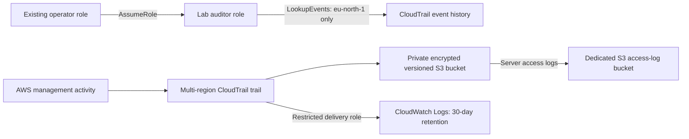

# GitHub DevSecOps Lab 05 — AWS IAM and CloudTrail Security

A practical identity and cloud-auditing lab using Terraform, AWS IAM,
CloudTrail, S3, IAM Access Analyzer and Checkov.

## Objectives

- Implement and test a narrowly scoped auditor role.
- Record management activity using a multi-region CloudTrail trail.
- Protect audit storage and verify its deployed configuration.
- Validate policies, assess security findings and demonstrate cleanup.

## Current implementation status — 24 October 2026

The original deployment was tested and destroyed on 21 October 2026.
The three improvements below are now implemented in Terraform and statically
validated; they have not been deployed or verified live.

- CloudTrail S3 lifecycle: 90 days current retention and 90 days noncurrent retention.
- Dedicated S3 access-log bucket: public access blocked, SSE-S3 AES256,
  versioning, bucket-owner-enforced ownership, HTTPS-only access and restricted
  S3 logging-service delivery. Retention defaults to 90 days current and
  90 days noncurrent. Destination self-logging is intentionally not enabled.
- CloudWatch Logs integration: a dedicated log group with 30-day retention
  and a delivery role restricted to the trail, account and CloudTrail log streams.
  No metric filters, alarms or live detections are configured.

These are learning-lab retention defaults, not enterprise retention requirements.
S3 lifecycle expiry makes current versions noncurrent; permanent deletion occurs
once the separate noncurrent period is met. Overwrites and deletions can start
that clock earlier. Lifecycle processing is asynchronous and is not an immutable
retention guarantee. Retention also applies to existing eligible objects.

## Architecture



The diagram represents current Terraform code; the access-log bucket and
CloudWatch delivery have not been deployed or tested live.

Event history and trail delivery are separate mechanisms.
The auditor can query event history; it has no permission to read S3 logs.

The trail records read and write management events, excluding KMS and
RDS Data API events. S3 data events and CloudTrail Insights are not configured.

## Tools

- AWS CloudShell and AWS CLI
- Terraform 1.16.6
- AWS provider 6.69.1
- Checkov 3.3.30
- IAM Access Analyzer
- GitHub Actions

## Security controls

- Trust limited to the existing operator role, resolved through an IAM lookup.
- Auditor permissions limited to CloudTrail LookupEvents in eu-north-1.
- All four S3 Block Public Access settings enabled.
- SSE-S3 AES256 default encryption and S3 versioning enabled.
- Bucket policy requires HTTPS and restricts CloudTrail delivery by trail ARN.
- Multi-region management-event logging and log-file validation enabled.
- Nonempty bucket deletion blocked by force_destroy = false.

## Verified results — 21 October 2026

| Test | Observed result |
|---|---|
| Terraform validation | Passed |
| Live deployment | 8 resources created in eu-north-1 |
| S3 public access controls | All four enabled |
| Default encryption | AES256 |
| Versioning | Enabled |
| CloudTrail configuration | Multi-region and log-file validation enabled |
| Log delivery | Event files and digest files delivered to S3 |
| Event inspection | One delivered file contained 30 records, including AssumeRole |
| Auditor lookup in eu-north-1 | Allowed |
| Auditor lookup in eu-west-1 | Access denied |
| Auditor IAM ListRoles | Access denied |
| IAM Access Analyzer | No findings for the auditor identity policy |
| Post-deployment Terraform plan | No changes |
| Checkov static scan | 55 passed, 8 failed, 0 skipped |
| Cleanup | 8 resources destroyed |
| Independent AWS cleanup checks | Bucket, role and trail not found |

Evidence is stored in [docs/evidence](docs/evidence/).
Raw event logs were backed up privately outside this repository.

Log-file validation was enabled; cryptographic verification of the
delivered digest chain was not performed. Read-only denial tests do not
prove every possible unauthorised action is blocked.

## Security findings

The 24 October 2026 Checkov 3.3.30 scan returned 113 passed, 12 failed,
0 skipped. Lifecycle configuration, source-bucket access logging and
CloudWatch integration checks now pass. Remaining failures cover KMS,
SNS, replication, notifications, incomplete multipart-upload cleanup and
CloudWatch retention shorter than one year. Findings count individual
check/resource pairs; adding resources changes the comparison baseline.

See [security findings and limitations](docs/security-findings.md).
These are documented learning-lab gaps, not formally approved enterprise exceptions.

## Reproduce the configuration

Prerequisites: Terraform, AWS CLI, Checkov and an authenticated AWS identity
with the necessary permissions. The trust configuration expects an existing
IAM role named AccountFullAccessRole; adapt it for your own environment.

Run from the repository root:

```bash
terraform -chdir=terraform init
terraform -chdir=terraform fmt -check
terraform -chdir=terraform validate
checkov -d terraform --framework terraform --compact --skip-download
terraform -chdir=terraform plan -out=lab05.tfplan
```

The scan currently returns a failure status because 12 findings remain open.
Planning does not deploy infrastructure.

Only after reviewing the plan and approving costs:

```bash
terraform -chdir=terraform apply lab05.tfplan
```

Use temporary role credentials for the auditor tests. Never commit credentials,
Terraform state, saved plan files or raw CloudTrail logs.

## Cleanup

Stop the lab trail, preserve evidence and back up required logs.
Disable source-bucket access logging, allow for delayed deliveries, and
empty all object versions and delete markers in both lab buckets before
applying a reviewed Terraform destruction plan. Both buckets use
force_destroy = false. Dependencies remove the logging configuration before
its destination, but do not empty either bucket or guarantee that delayed
logs have finished arriving. Export required CloudWatch events first:
the log group and its events are deleted during destruction (skip_destroy = false).

```bash
terraform -chdir=terraform plan -destroy -out=lab05-destroy.tfplan
terraform -chdir=terraform apply lab05-destroy.tfplan
```

Verify resource absence through AWS APIs.
The recorded deployment has already been destroyed; no redeployment is
needed to inspect this portfolio.

## GitHub Actions

The workflow checks formatting, initialises the provider, validates Terraform
and runs Checkov without AWS credentials or deployment permissions.

The security job is expected to fail while the documented findings remain.
Workflow execution must be checked after publication; a local YAML parse
does not establish a successful GitHub run.

## Problems encountered and solutions

- CloudShell lacked Terraform: downloaded the Linux AMD64 release and
  verified its ZIP against the published SHA256 checksum.
- AWS provider installation exceeded home-folder capacity:
  used TF_DATA_DIR=/tmp/lab05-terraform-data.
- CloudTrail initially showed no event files: continued IAM testing and
  subsequently verified delivery.
- Versioning required explicit object-version cleanup: backed up and
  deleted 27 versions before destroying the bucket.
- Budget email verification remained blocked: an AWS Support case was
  already pending. Active email alerts are not claimed.

CloudShell temporary tool storage may disappear between sessions.
Reinstall tools and initialise again when necessary; retain configuration,
the provider lock file and evidence in persistent storage.

## Lessons learned

- Successful deployment does not establish correct permissions or log delivery.
- Event history lookup and S3 audit-log delivery need separate verification.
- Test both allowed and denied operations when assessing least privilege.
- Versioned storage requires deliberate cleanup of historical versions.
- Static findings, live results and production readiness are different claims.

## Enterprise relevance

Demonstrates restricted audit access, evidence-based control verification,
cloud activity investigation, infrastructure change review and accountable
resource cleanup. Production use would require resolving the documented
gaps, defining retention and recovery requirements, and testing monitoring
and incident-response processes.

## Historical GitHub Actions execution

[Workflow run 39657133185](https://github.com/SkynetAI-Labs/lab-05-aws-iam-cloudtrail-security/actions/runs/39657133185)
completed on 21 October 2026.

- Terraform formatting, initialisation and validation passed.
- Checkov completed: 55 passed, 8 failed, 0 skipped.
- The security job and overall workflow failed because the eight documented
  findings remain open. No checks were suppressed.
- Runner annotations reported Node.js action-runtime deprecation warnings.

## Updated static validation — 24 October 2026

[Workflow run 40131368211](https://github.com/SkynetAI-Labs/lab-05-aws-iam-cloudtrail-security/actions/runs/40131368211)
checked commit `71316c64d333ed262b64ab25882854c91b539ba2`.

- Terraform 1.16.6 formatting check passed.
- Initialisation without a backend passed using locked AWS provider 6.69.1.
- Terraform validation passed.
- Checkov 3.3.30 completed: 113 passed, 12 failed, 0 skipped.
- The validation job passed; the security job and overall workflow failed.
- No findings were suppressed and no AWS deployment was performed.
- Node.js action-runtime deprecation warnings remained visible.

Before any future deployment, assess CloudWatch ingestion, storage and query
costs and S3 access-log storage costs using current eu-north-1 pricing and
expected volume. Review permissions, resource names, retention, evidence
export and cleanup procedures. Deployment requires separate explicit approval.
